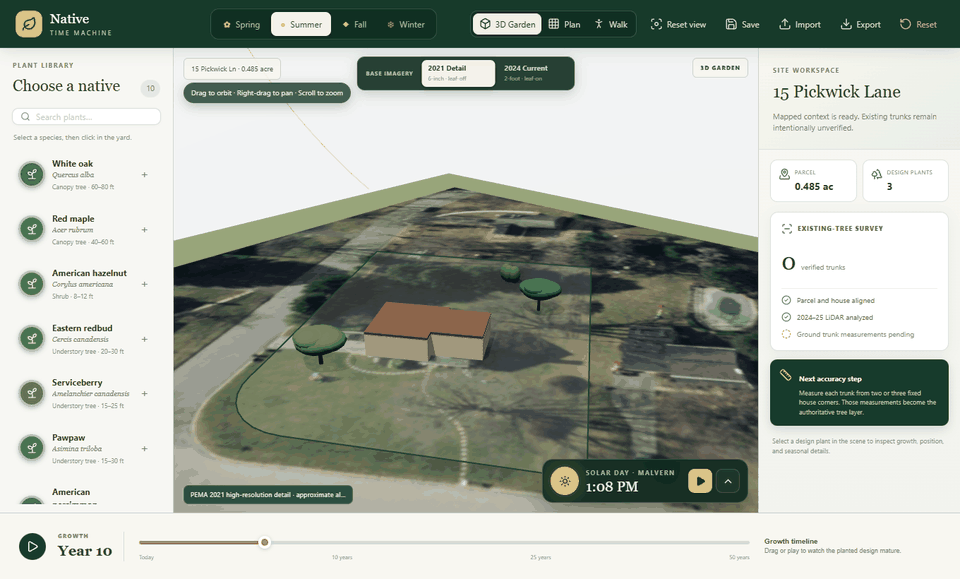

# Native Time Machine

Native Time Machine is a browser-based landscape planner that lets homeowners place native trees and shrubs at real-world scale and preview how their design changes through 50 years, four seasons, and a full solar day. The current site model uses public parcel and building-footprint geometry for 15 Pickwick Ln in Malvern, Pennsylvania.



## What works today

- The mapped 0.485-acre Pickwick Lane parcel, including its curved frontage and irregular boundary
- A dimensional house generated from the county's 2015 building footprint
- A clean property baseline with no unverified existing trees preloaded
- A default orbitable perspective garden with sky, lighting, shadows, volumetric plants, and visible vertical growth
- A ground-level Walk mode with pointer-lock mouse look, keyboard movement, sprinting, collision boundaries, and Xbox-style dual-stick controls
- A maximum-height 3584 × 4096 px PEMA leaf-off aerial with GPU anisotropic filtering, preserving path and ground detail in overhead and oblique views
- Date-specific solar playback driven by NREL's Solar Position Algorithm, with live azimuth, elevation, sunrise, solar noon, sunset, a visible sun path, and roof shadows
- An optional orthographic Plan view with a 5 ft measurement grid, zoom, pan, planting, selection, and drag-to-move
- Searchable catalog of ten native trees, shrubs, and perennials
- Species-specific growth curves from installation size toward typical mature height and canopy width
- Spring, summer, fall, and winter rendering driven by catalog data
- Selected-plant dimensions, maturity, preferences, notes, duplication, and deletion
- A 0–50 year timeline with playback
- Automatic localStorage persistence plus explicit save, JSON export/import, and design reset
- Unit tests for growth, coordinate transforms, and serialization

Botanical dimensions are representative ranges, not site predictions. The catalog identifies modeling assumptions, and the simulation stays separate from rendering so validated regional models can replace them later.

## Start the app

Requires a current Node.js LTS release.

```bash
npm install
npm run dev
```

Then open the URL printed by Vite. For a production check:

```bash
npm test
npm run lint
npm run build
```

## How to use it

1. Pick a species in the left catalog.
2. Click in the yard to plant it.
3. Select or drag a canopy to inspect or reposition it.
4. Move the timeline or press Play to watch it mature.
5. Switch seasons in the top toolbar.
6. Save locally or export the complete design as JSON.

Undo and Redo in the toolbar (Ctrl/Cmd+Z, Ctrl/Cmd+Shift+Z or Ctrl+Y) restore planting, complete drags, duplication, deletion, import, and reset, with up to 100 edit steps in the current session. Placement, movement, duplicates and new imports reject locations outside the parcel or inside the house. Existing saved positions are retained. Imports are validated before replacement and can be undone. The first save preserves the original stored JSON under `landscape-time-machine/design/v8/backup`; saving failures are reported without discarding the active design.

Choose **Solar ground** in the imagery controls for a neutral surface showing simulated shadows without permanent photographed shadows. Aerial modes also receive a separate simulated shadow overlay; their original photographed shadows remain fixed. Roof and plant geometry still determine the accuracy of simulated shade. The sky darkens after twilight.

Use the solar console in the lower-right corner to choose a date, scrub the local time, or press Play to watch the sun and modeled shadows cross the property. The default representative day is July 15; the `July 15` button restores that midsummer baseline.

In 3D Garden view, left-drag orbits, right-drag pans, and the mouse wheel zooms. Switch to Plan for precise overhead positioning. All internal property and plant coordinates use feet in a right-handed Three.js scene (`x` east/west, `z` north/south, `y` vertical).

### Walk mode

Choose **Walk** in the top view switch to explore the landscape at a 5.6-foot eye height. Click the 3D view to capture the mouse (or drag to look if Pointer Lock is unavailable); move with **WASD** or the arrow keys, hold **Shift** to sprint, press **Esc** to release the mouse, and press **Q** to exit. With a standard Xbox-style gamepad, use the left stick to move, the right stick to look, press the left stick to sprint, and press **B** to exit. Walk mode stays inside the parcel, blocks the house and modeled trunks, and allows movement beneath tree canopies.

## Architecture

### Spectator mode

Walk traversal: tap **A** to jump. Assisted climbing is temporarily disabled after a Walk-mode rendering/input regression. Walk uses the previous ground-following controller; the climb prototype and its geometry tests remain available for future work.

Star up to four species in the plant library to build your **Plant kit**. Those favorites fill the first four Xbox equipment-wheel slots in the same order; Move and Cancel remain in the last two slots. Remove a star to free a slot. Favorites save separately from the version 8 landscape design, so kit changes do not affect placements or undo history. An empty kit leaves the plant slots empty.

**Esc** closes the equipment wheel without planting. The planting summary blocks background Undo/Redo shortcuts while open. Camera shortcuts adapt their orbit and clipping limits for narrow views; manual orbiting cancels the active shortcut.

In Garden or Plan, **Summary** lists species quantities, planned versus existing counts, plant-center coordinates in feet, and approximate height/canopy size at the current simulation year. Coordinates use the site's local X/Z frame, not a surveyed corner. **Front / Back / Left / Right** provide smooth property views; select a tree and choose **Focus plant** to frame its current size. These shortcuts open the 3D Garden from Plan. Dragging the camera interrupts the transition, and Reset view returns to the default framing. Front/back/left/right are camera-relative property views, not surveyed cardinal directions. Walk and Spectator keep their separate camera controls.

Choose **Spectator** for unrestricted camera flight without plant editing, collision, gravity, or parcel constraints. Mouse look uses capture or drag; WASD/arrows fly toward the camera direction, Space/E ascends vertically, Q/C descends, Shift flies faster, and F exits. On a standard Xbox controller use LS to fly, RS to look, RB up, LB down, L3 fast flight, LT zoom, and B exit. Reset view restores the overview. Planting, carrying, equipment, deletion, importing, resetting the design and undo/redo are blocked while spectating. Camera position is transient and never changes saved plant coordinates.

Inspired by [Embark's free-fly camera notes](https://www.reachthefinals.com/patchnotes/600), including ascent relative to the world rather than the look direction. Xbox mappings here are an adaptation for this planner.

Hold **LB** in Walk mode for the plant equipment wheel, use **RS** to choose, then release **LB** to equip. It includes White oak, Red maple, Eastern redbud, Serviceberry, Move plants and Cancel. **X/RT** plants an equipped preview; **B** cancels a preview or wheel before exiting. The wheel pauses movement and aim. See [controller QA and research](docs/controller-qa.md) for controls, source references and test coverage.

Walk controller additions: **A** makes a small jump, **LT** holds a modest zoom, **X** picks up the plant under the reticle (within 65 ft), and **X** or **RT** drops it 12 ft ahead. Held plants are transient previews; a valid drop is one undoable edit. Invalid locations remain blocked. Exiting Walk or losing focus cancels a pickup. Look input has an adjustable 25% default deadzone and a gentle response curve, with no aim recentering or inertia. Use the Walk HUD deadzone slider if a worn stick still drifts. Standard Xbox-compatible gamepad mapping is required.

```text
src/
├── components/          React UI and React Three Fiber scene
├── data/catalog.ts      Botanical records and rendering palettes
├── simulation/          Pure growth and coordinate functions
├── persistence/         Versioned JSON/localStorage boundary
├── store/               Zustand application state and actions
└── types.ts             Domain contracts
```

The major boundaries intentionally match the product roadmap:

- **Property geometry:** `PropertyDesign` owns physical dimensions; transforms stay renderer-independent.
- **Species and instances:** catalog records describe biology, while placed plants contain identity, species, location, and planting year.
- **Simulation:** pure functions compute dimensions. They know nothing about React or Three.js.
- **Seasonal rendering:** descriptions and color palettes live in species data, enabling future geometry/material swaps.
- **Interaction:** perspective and orthographic cameras plus pointer behaviors are isolated in the canvas layer.
- **Persistence:** a versioned schema provides a migration seam for future cloud storage.
- **Geospatial ingestion:** future parcel/building providers can produce property geometry without changing growth logic.

## Technology choices

- React + TypeScript + Vite for a fast, strongly typed web application
- Three.js through React Three Fiber and Drei for a scene that can evolve from overhead planning to immersive 3D
- Tailwind CSS tooling, with a compact bespoke design layer for the application shell
- Zustand for centralized actions without coupling domain logic to React context
- Vitest for fast tests against pure core modules
- Browser localStorage for zero-account Phase 1 persistence

Dependencies use current stable npm release tags during initial scaffolding; `package-lock.json` pins the installed, verified set.

## Growth model

Each species has an establishment period, half-maturity point, maturity year, and installed height/width. A normalized logistic curve produces biological progression, then independently interpolates height and canopy dimensions. Perennials mature in roughly two years, shrubs in about 10–12, and long-lived canopy trees across decades. This is deliberately more meaningful than one global scale factor, but remains a visual planning estimate rather than an arboricultural forecast.

## Property geometry and accuracy

The property model is centered on Chester County parcel UPI `54-2C-45` and keeps the county State Plane coordinates as local offsets measured in feet. The county record reports 21,125 square feet (0.484963 acres); the mapped polygon area is approximately 22,666 square feet. The house uses the 2015 county building footprint (approximately 1,297 square feet), while the public assessment record reports 2,307 square feet of finished living area.

Sources:

- [Chester County authoritative parcel feature service](https://www.arcgis.com/home/item.html?id=743f6f125f1e41589c0c9841d65a0ade)
- [Chester County ChescoViews](https://www.chesco.org/2198/ChescoViews)
- [Public property record](https://www.redfin.com/PA/Malvern/15-Pickwick-Ln-19355/home/38767659)

County parcel geometry is an approximate mapping reference, not a boundary survey. Its frontage must not be snapped to a pavement edge without survey evidence: a mapped boundary, right-of-way and pavement edge can differ. The [county parcel service](https://services.arcgis.com/G4S1dGvn7PIgYd6Y/arcgis/rest/services/Parcels_owners/FeatureServer) explains that the parcel mapping was historically adjusted to older photography and is not survey information.

Ground now uses a four-foot grid interpolated from classified ground returns in the locally cached 2024–25 PASDA tile. The aerial texture, boundary, plants and walking camera follow that surface. Roof geometry uses 1,229 above-ground returns within the county house footprint, fitted to five supported planes with 0.071–0.125 ft residual RMSE. These residuals describe agreement with supporting points, not absolute site accuracy. The resulting triangulated roof is a reconstruction, with inferred transitions and no verified eaves, chimneys or dormers. Walls connect its perimeter to the ground. Run `.venv/Scripts/python scripts/build_pickwick_surface.py` to regenerate `src/data/pickwickSurface.json` from the cached LAZ. Sparse areas use inverse-distance interpolation; coverage outside the parcel is context only.

### Solar position and shadow accuracy

The sun direction uses the [NREL Solar Position Algorithm](https://midcdmz.nlr.gov/spa/) at 40.028618° N, 75.531244° W. Inputs include the derived 586.369-foot LiDAR baseline elevation, a reference pressure of 992 hPa, a 15°C reference temperature, and the correct America/New_York UTC offset for each selected date. True-north directions are rotated approximately 1.44 degrees into the county State Plane grid using the georeferenced aerial orientation. The NREL SPA implementation is distributed subject to the terms documented by NREL; the JavaScript wrapper is MIT licensed.

The astronomical position and the 3D site model have different accuracy ceilings. Shadows now use LiDAR terrain and reconstructed pitched roof geometry, improving on the previous flat roof and ground. Eaves, chimneys, neighboring structures and existing trees still require verification. The playback remains a planning aid, not a solar-panel production estimate or professional shade study.

### Existing-tree data

No existing trees are currently preloaded. A canopy center is not a trunk, and merged crowns cannot establish tree count. Five earlier imagery-derived points were removed after review because they did not meet that standard.

Newer public LiDAR is available: PASDA tile `27002580PAS_SE_SE` covers the parcel and comes from the USGS PA 17 County 2024 South project, whose acquisition range is April 2024–April 2025. The tile contains 8,628,766 points; the parcel subset has approximately 1.34 all returns per square foot. It is valuable for terrain, canopy structure, and possible height estimates, but its local classifications are only ground, unclassified, noise, and high noise—there is no tree-trunk class.

The reproducible [`scripts/analyze_pickwick_lidar_2024.py`](scripts/analyze_pickwick_lidar_2024.py) inspection requires actual low returns within a 1.25-foot column across at least four one-foot height slices. It leaves six weak results as remote candidates, not accepted trees; dense backyard stems remain unresolved. The generated [JSON report](data/analysis/pickwick_lidar_2024_report.json) and [diagnostic image](data/analysis/pickwick_lidar_2024_diagnostic.png) document that result. A ground stem inventory using redundant tape or laser distances from fixed house/control points is the next authoritative input.

The [`scripts/analyze_pickwick_imagery.py`](scripts/analyze_pickwick_imagery.py) alignment and color-infrared experiment remain available for canopy context only. They must not be used to create trunk points.

The app's 2021 detail layer is a reproducible 3584 × 4096 export, and the 2024 context layer uses the same aspect ratio at 1792 × 2048. Both match the requested Web Mercator bounds; requesting square images would silently pad the east–west extent and misalign the aerials with the parcel. The renderer uses the browser GPU's maximum supported anisotropic filtering plus trilinear mipmaps. This improves clarity while looking straight down or across the ground, but it cannot reveal detail beyond the source imagery's nominal ground resolution. Run [`scripts/fetch_pickwick_aerial.py`](scripts/fetch_pickwick_aerial.py) to regenerate both checked-in exports from PASDA.

Free imagery sources:

- [Pennsylvania imagery acquisition timeline](https://www.arcgisserver.oa.pa.gov/EWG/timeline/imagery/index.html)
- [PASDA 2024 NAIP natural-color service](https://imagery.pasda.psu.edu/arcgis/rest/services/pasda/NAIP2024/MapServer)
- [PASDA 2024 NAIP color-infrared service](https://imagery.pasda.psu.edu/arcgis/rest/services/pasda/NAIP2024_InfraredWEB/MapServer)
- [PEMA 2021–2023 six-inch imagery service](https://imagery.pasda.psu.edu/arcgis/rest/services/PEMAImagery2021_2023/MapServer)

An earlier experiment derived canopy segments from the public USGS 3DEP `USGS_LPC_MD_PA_SandySupp_2014_LAS_2016` point cloud, but visual comparison showed that the 2014 acquisition does not represent the property accurately enough today. Those records remain excluded from the default design. The reproducible [`scripts/analyze_pickwick_lidar.py`](scripts/analyze_pickwick_lidar.py) experiment is retained only for provenance.

LiDAR sources:

- [PASDA 2024 South classified LAZ tile](https://www.pasda.psu.edu/download/usgs/PA_17County_2024/PA_State_Plane_South/point_cloud/tilecls/27002580PAS_SE_SE.laz)
- [PASDA LiDAR tile index](https://imagery.pasda.psu.edu/arcgis/rest/services/PA_Lidar_Navigator/MapServer/52)
- [USGS 3DEP LiDAR Explorer](https://www.usgs.gov/tools/lidarexplorer)
- [USGS 3DEP public EPT catalog on AWS](https://registry.opendata.aws/usgs-lidar/)

Do not buy imagery before completing the ground inventory. Commercial DSMs and tree polygons still do not guarantee hidden trunk centers, and Google imagery is not used for extraction because its standard terms restrict derived datasets and nonvisual analysis.

## Roadmap

### Phase 2 — Immersive 3D

Perspective and first-person modes, richer procedural/GLTF plants, environmental lighting, shadows, bark/leaves/flowers, and animated transitions between planner and ground views.

### Phase 3 — Real properties

Field-measured trunk import, new-LiDAR terrain and candidate heights, address geocoding, and manual corrections. Provider use must follow licensing, cost, coverage, attribution, and export restrictions.

### Phase 4 — Advanced simulation

Canopy collisions, spacing guidance, sunlight/shade, regional recommendations, soil/moisture fit, multiple scenarios, comparisons, and calibrated long-term growth datasets.

## Current limitations

- Parcel and footprint geometry are public GIS approximations; roof heights and slopes are fitted to LiDAR, with transitions and small features unverified.
- Solar astronomy is high-accuracy, but roof and obstruction shadows remain limited by unsurveyed 3D geometry and reference atmospheric inputs.
- No existing-tree points are accepted yet; current LiDAR and imagery provide canopy context but do not resolve every trunk beneath overlapping crowns.
- Plant geometry is intentionally procedural and stylized rather than photorealistic, but it is fully volumetric and species-scaled.
- Growth estimates do not yet account for climate, cultivar, competition, soil, or maintenance.
- The design schema has runtime boundary checks but is not yet backed by a formal schema package.
- There is no account, collaboration, backend, or geospatial service in Phase 1.

## Data and scientific responsibility

Typical dimensions and preferences are approximate, synthesized from commonly reported horticultural ranges. The UI labels the simulation as an estimate. Before using results for planting, utilities, structures, fire safety, or regulated setbacks, users should verify the species and site with local extension resources and qualified professionals.
